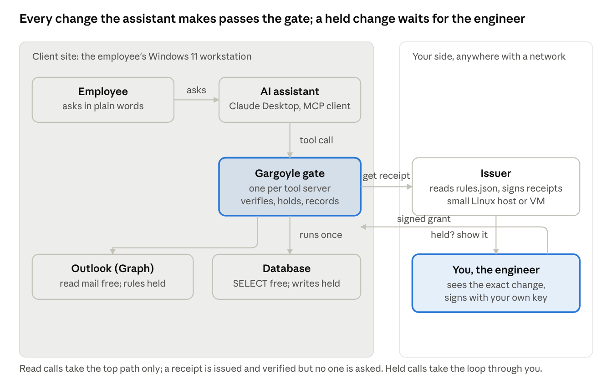

# Gargoyle: supervised AI at a client workstation

2026-10-16, Justin LaPorte

## Abstract

An employee at a client site uses an AI assistant on a Windows 11 workstation to manage their Outlook inbox and query the company's database. Gargoyle sits between the assistant and those two systems. Reads go through at once. Any change that could alter mail flow or data, such as creating an inbox rule, updating or deleting records, or exporting a table, stops until the client's managing engineer, sitting elsewhere, reads exactly what is about to happen and signs an approval with a key the assistant cannot reach. The assistant then performs exactly that action, once, and the workstation hands back a signed record of what was authorized, who released it, and what ran. The client gets the efficiency of an assistant that can act, without the risk of an assistant that acts unsupervised, and every change leaves evidence that can be verified later with three public keys and no server running.

Nothing in the assistant or the client's systems is modified. The gate is a small program the assistant talks to instead of the systems directly, a policy file the engineer edits, and an approval terminal on the engineer's side. What follows is the scene, the hardware, the end-to-end process, what each screen shows, and the honest limits.

## The scene

A bookkeeper at the client opens Claude Desktop on their Windows 11 machine and asks it to tidy the inbox and pull last quarter's unpaid invoices. The assistant has two tool servers: one for Outlook over Microsoft Graph, one for the finance database. Neither is reachable by the assistant directly. Each sits behind a Gargoyle gate the assistant was configured to talk to instead.



When the assistant reads mail or runs a SELECT, the gate gets a receipt from your issuer, checks it against the pinned keys, runs the call once and records it. The employee notices nothing. When the assistant tries to create an inbox rule that forwards invoices to an outside address, or to update the invoice table, the gate gets a receipt marked *hold* and waits. Your terminal shows the rule or the SQL, byte for byte, with the employee's identity and the policy version that allowed it. You type approve, or you don't. The assistant tells the employee the change was approved and done, or that it was declined.

## Required hardware and software

Nothing exotic: the client's existing workstation, one small host you control, and your laptop. The one thing that must be true is that the assistant holds no credentials of its own to Outlook or the database; it reaches them only through the gate.

| Where | What | Exists today | Notes |
| --- | --- | --- | --- |
| Client workstation | Windows 11, 8 GB RAM, Python 3.14, Node 20+ (for npm-distributed MCP servers), Claude Desktop | yes | The gate runs as the employee's own process, launched by Claude Desktop from its config. No admin rights beyond installing Python. |
| Client workstation | Outlook MCP server over Microsoft Graph, running with the employee's own Microsoft 365 sign-in | choose and vet | Several community servers exist; pick one, read its code, pin its version. Its tools (list mail, read mail, create rule) are what the policy names. |
| Client workstation or server | Database MCP server: Microsoft's MSSQL server, or the SQLite server for file databases | choose and vet | Runs with a database login scoped to the tables the assistant may touch; the gate decides which statements are free, held or denied. |
| Your side | Issuer host: any Linux box or VM, 1 vCPU, 1 GB, reachable from the client over HTTPS | yes (HTTP); TLS front needed | `gargoyle issuer` on the host behind a TLS reverse proxy (Caddy or nginx). Holds `rules.json` and the issuer key. One instance per client, or one with per-client rules. |
| Your side | Approver machine: your laptop or workstation with the package installed and `approver.env` | yes | `gargoyle approve --watch 2` in a terminal. The approver key lives here and nowhere else. |
| Your side | A hardware key (YubiKey or similar) for the approver signature | not yet | Today the key is a file with mode 600. Hardware-backed signing is on the roadmap; until then, a dedicated machine for approving is the control. |
| Your side | A phone or web approval button | not yet | Today you approve in a terminal. A web or Slack approval console is roadmap step 6. |

Software on both sides is the one Python package (`gargoyle-receipts`) and its command. The client's assistant, Outlook and database are unchanged.

## End-to-end process

One afternoon of setup, then a routine the employee never sees and you see only when something needs your signature.

**Setup, once per client (you, about an hour)**

1. On your issuer host: `gargoyle init <client-name>` generates the issuer key, your approver key, the identity key and the client's token, writes `rules.json` and the config files, and prints the public keys for audits.
2. Edit `rules.json`: name the Outlook and database tools as allow, hold or deny. The first draft below took three minutes.
3. `gargoyle issuer` on the host, behind your TLS proxy. It publishes the policy record the gate anchors on.
4. On the client workstation: install Python and the package, place `middleware.env` and `record.json`, and paste the two server entries from `mcp-config.json` into Claude Desktop's configuration, one for Outlook, one for the database. Remove any direct Outlook or database tool the assistant had before. Restart Claude Desktop.
5. Move `approver.env` to the machine you approve from and delete it from the issuer host. Nothing else holds your key.

**A free call (the employee, every few minutes)**

1. The employee asks: "show me invoices over 30 days unpaid." The assistant calls the database tool with a SELECT.
2. The gate sees no receipt on the call, sends tool and arguments to your issuer under the client's token, and gets back a signed receipt bound to that SQL, that principal and that target. Elapsed: under a second.
3. The gate verifies the receipt against the pinned issuer key and the policy record, claims its id so it can never be spent twice, forwards the call to the database server, and returns the rows with the receipt chain in the response metadata.
4. The employee sees the table. Nobody was asked.

**A held call (the employee, you, a few times a day)**

1. The employee asks: "make a rule that forwards anything from Acme to our bookkeeper." The assistant calls the Outlook tool `create_rule` with the rule's conditions and actions.
2. The gate requests a receipt. The rules file says `create_rule` is *hold*, so the receipt comes back flagged with a hold id, and the gate starts waiting, polling your issuer every two seconds for up to five minutes.
3. Your terminal, already running `gargoyle approve --watch 2`, prints the hold: tool, the full arguments (the rule, verbatim, checked against the hash in the receipt), the employee's identity, the target, the policy version, and when it expires.
4. You read the rule. It forwards to an outside address. You type nothing, or you type `approve`. Approving signs a grant with your key, bound to that exact decision and hold id, and posts it to the issuer.
5. The gate receives the grant, verifies it against your pinned public key and the receipt, spends grant and receipt once, forwards the call, and signs an execution receipt for what ran.
6. The employee's assistant reports the rule was created, or, after five minutes with no grant, that the change was not approved. A declined change leaves no trace in Outlook and a hold that expires with the receipt.

**A denied call (no one, instantly)**

The assistant tries `DELETE FROM invoices` or `delete_rule`. The rules file says deny. The issuer refuses before any receipt exists; the gate answers the assistant with the reason; the database server never hears of it.

**Audit (you or an auditor, any time later)**

Each honored response carried receipt, grant and execution receipt. `gargoyle audit receipt.json execution.json grant.json` on any machine with the three public keys prints each step and `CHAIN_VERIFIED`: this policy version authorized this call for this employee's assistant, you released it, and exactly this ran. No issuer, no network, no trust in the workstation required.

## What it looks like

**Your screen.** A terminal, left open. Most of the day it is silent. When a hold arrives it prints this (the arguments are shown only because they hash to the receipt; if they did not, the line would say so and the CLI would refuse to sign):

```
About to APPROVE a held high-impact decision:
  decision_sha256     : 6186ac4b...a8c4
  approval_request_id : 7f5131db-a752-4e5d-aff1-ecac1b66f89c
  tool                : create_rule
  args_sha256         : e2363d59...bab7
  principal           : spiffe://acme.example/assistants/bookkeeping
  on_behalf_of        : j.doe@acme.example
  target_url          : mcp://outlook/j.doe@acme.example
  policy              : {'policy_id': 'gargoyle.rules/1', 'policy_sha256': '19122a04...bf8c'}
  not_after           : 2026-10-16T19:21:28+00:00
  arguments (bound by args_sha256):
    {
      "name": "Acme invoices",
      "conditions": {"from": "billing@acme-supplier.com"},
      "actions": {"forward_to": "books@outside-firm.com", "move_to": "Invoices"}
    }
Type 'approve' to sign a grant: 
```

You type `approve` and press Enter, or you type anything else. That is the whole interaction. The roadmap replaces the terminal with a web or Slack button; the signature and what you see stay the same.

**The employee's screen.** Claude Desktop, as always. For a read, the answer appears. For a held change, the assistant's tool call spins for as long as you take, then reports "Rule created" or "This change was not approved." For a denied one, it reports the reason at once, for example "DESTRUCTIVE_TOOL". The employee never sees a key, a receipt or a terminal.

**The policy you edit.** `rules.json` on the issuer host. First match wins; edit it and the policy pin changes, so anything in flight is re-decided.

```json
{
  "version": "acme-2026-10",
  "default": "deny",
  "rules": [
    {"tools": ["list_*", "read_*", "search_*", "get_*"],          "action": "allow"},
    {"tools": ["query"], "args": {"sql": "SELECT*"},               "action": "allow"},
    {"tools": ["query"], "args": {"sql": "UPDATE*"},               "action": "hold"},
    {"tools": ["query"], "args": {"sql": "INSERT*"},               "action": "hold"},
    {"tools": ["query"],                                             "action": "deny", "reason": "SQL_NOT_PERMITTED"},
    {"tools": ["create_rule", "update_rule", "move_message"],       "action": "hold"},
    {"tools": ["send_mail", "forward_mail"],                         "action": "hold"},
    {"tools": ["delete_*", "empty_*"],                               "action": "deny", "reason": "DESTRUCTIVE_TOOL"}
  ]
}
```

The tool names come from whichever Outlook and database MCP servers you pick; the shape of the file does not change. Note that `DROP` and `DELETE` statements fall through to the deny rule because only `SELECT`, `UPDATE` and `INSERT` are named.

## What it guarantees, and what it does not

It guarantees that the change you approved is the change that ran. Specifically:

- No gated action runs without a receipt signed by your issuer for that tool, those exact arguments, that assistant, that employee and that target. A receipt for one change cannot be reused for another, or by another assistant, or twice.
- No held action runs without a grant signed by your key for that exact decision and hold. The assistant, the employee and the issuer host cannot produce one. The flag is inside the issuer's signature; it cannot be stripped.
- A policy change invalidates every receipt issued under the old policy. There is no window where an old permission outlives the rule that granted it.
- Every honored call leaves receipt, grant and execution receipt that anyone with the three public keys can verify offline, with the policy version recorded inside the executor's signature.

It does not guarantee:

- Coverage of anything that bypasses the gate. If the assistant, or the employee by hand, holds direct Outlook or database credentials, nothing is gated. The deployment rule is that the assistant has only the gate. The employee's own access stays under your existing controls.
- The quality of the review. The gate proves you saw the exact change and signed it. Whether a forwarding rule to an outside firm is a problem is still your judgment; the gate makes sure the judgment is exercised on the real thing.
- Isolation. The gate and the tool servers run as the employee's user on the workstation. Policy is the control, not a sandbox.
- Availability during your absence. A held call waits five minutes, then fails closed. Two approvers with their own keys, or a threshold of approvers, is roadmap step 4.

Two operational facts to plan for: one issuer instance keeps its pending holds in memory, so a restart drops holds that were waiting (the assistant simply retries); and the approver key is a file today, so the machine it sits on is the security boundary until hardware keys are supported.

## Rollout

Start with one client, one employee, two tools, and you as the only approver. That is a day of work, most of it choosing and vetting the Outlook and database MCP servers.

1. Pick and pin the two MCP servers. Read their tool lists; those names are what the rules file governs. Confirm each runs with a least-privilege login.
2. Run the filesystem example end to end on your own machine first (three commands); then swap in the two real servers and the client's rules file.
3. Install on the employee's workstation, remove any direct tool access the assistant had, and sit with the employee for the first held change so they understand the wait.
4. Keep `gargoyle approve --watch 2` open on your approving machine during working hours. Log the responses' receipt chains to a folder per client for the audit trail.

What to add, in order, as the engagement grows:

- A web or Slack approval console, so approving is a button on your phone (roadmap step 6).
- Approver roles and a second approver or a threshold for the riskiest tools (roadmap step 4).
- An evidence log collecting every chain in one place (roadmap step 5).
- Hardware-backed approver keys.

The pitch to the client fits in one sentence: your staff's assistant can read everything it needs, it can change nothing I have not personally signed, and every change it makes is provable afterwards.
